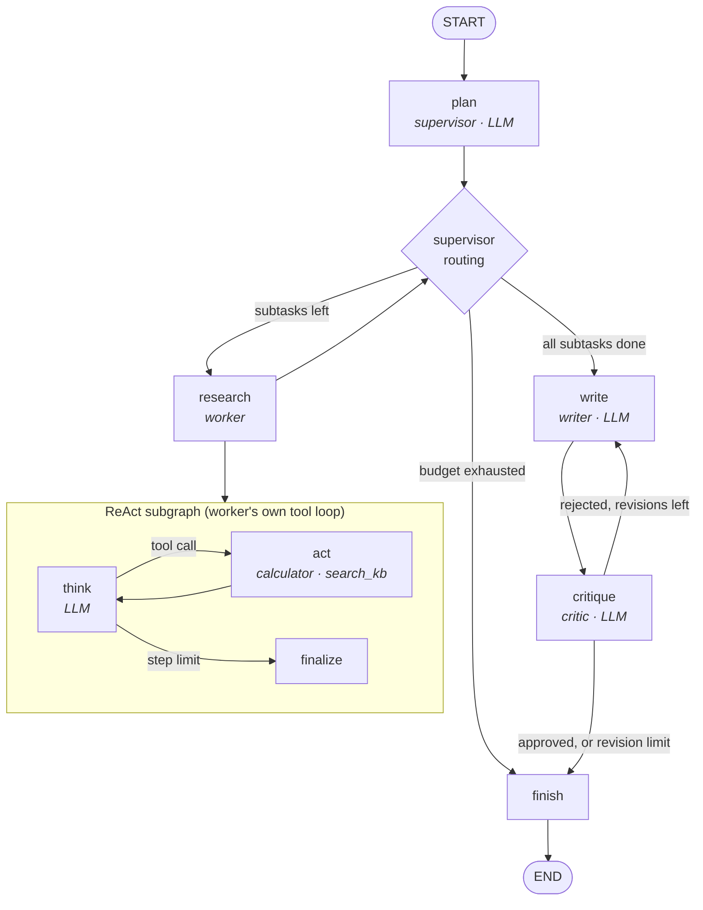

# multi-agent-orchestrator

A hierarchical multi-agent system built on **LangGraph**. A supervisor plans the work and delegates it to research workers. Each worker reasons and calls tools in a ReAct loop. A writer drafts the answer, and a critic scores the draft and sends it back for revision within a bounded budget. The graph checkpoints its state, so a run can pause for human review and resume later. Every step is traced with its duration, token counts, tokens/sec and cost.

The project runs offline with a deterministic rules-based model, so the whole graph can be tested and demonstrated without credentials. Gemini on Vertex AI is available as a drop-in model.



## Patterns demonstrated

| Pattern | Where | What it does |
|---|---|---|
| **Hierarchical delegation** | `graph.py` | The supervisor (`plan` + routing) owns the plan. Research workers handle each subtask, and writer and critic are separate roles. |
| **ReAct** | `react.py` | A worker subgraph alternates `think` (JSON action) and `act` (tool call). It handles malformed output and tool failures as observations, and has a hard step limit. |
| **Self-reflection** | `graph.py`, `parsing.py` | The critic scores the draft 1 to 10 against the findings. A rejected draft goes back to the writer with the critic's issues as feedback. Rewrites are capped, and the run ends with `revision_limit` if they run out. |
| **State management** | `state.py`, `graph.py` | Typed state with reducers (`operator.add`) for accumulating findings, events and costs. Nothing relies on mutable globals. |
| **Checkpointing and human-in-the-loop** | `runner.py`, tests | With `interrupt_before=["write"]`, the run pauses before each draft. A reviewer can edit state with `update_state` and resume. |
| **Budgets as guardrails** | `config.py`, `graph.py` | Caps on model calls and USD. A run that hits its budget stops early, returns the findings it has, and reports `budget_exhausted`. No extra model calls happen. |
| **Granular tracing** | `telemetry.py` | Every step is an event with node, role, duration, prompt and completion tokens, tokens/sec and cost. `summarize()` gives the path and totals. |

## Quickstart

```bash
python -m venv .venv && source .venv/bin/activate
pip install -e ".[dev]"

pytest -q          # 37 tests, including pause/edit/resume and budget tests
ruff check .

orchestrate "Compute 30 * 24 * 3 * 0.12 and summarise our autoscaling policy"
orchestrate "Compute 30 * 24 * 3 * 0.12 and summarise our autoscaling policy" --json
```

Example output, abridged. Timings vary by machine, but the path and call counts are deterministic:

```text
status: completed   revisions: 1
answer:
Answer to: Compute 30 * 24 * 3 * 0.12 and summarise our autoscaling policy
- Compute 30 * 24 * 3 * 0.12 -> 259.2 [1]
- summarise our autoscaling policy -> The API service scales out by one replica when ... [2]

Sources:
[1] calculation
[2] autoscaling
...
llm_calls=9   ...
```

The first draft has no `Sources:` section, so the critic rejects it. The writer then revises, and the second draft is approved. That is the self-reflection loop running on its own.

Demonstrate the budget guard with `--max-llm-calls 3`. The run then reports `budget_exhausted` and still returns the findings it has.

## Development workflow

```bash
make install            # create .venv and install the dev dependencies
make check              # lint and tests
make run TASK="..."     # run the agent team and print the step trace
make trace TASK="..."   # same run, with the JSON trace written to .demo/trace.json
```

Agent instructions are versioned with the code. [`AGENTS.md`](AGENTS.md) is the shared guide for coding agents and human contributors. [`CLAUDE.md`](CLAUDE.md) imports it and adds workflow rules for the agent in this repository. `src/orchestrator/CLAUDE.md` holds rules for the graph code. The `.claude/` directory contains:

- `settings.json`: pre-approved commands, commands that need confirmation, and denied file reads
- `hooks/post_edit.py`: formats and lint-fixes each edited Python file, and reports lint errors that remain
- `commands/`: the `/check`, `/run-task` and `/review-trace` slash commands
- `agents/`: a read-only `graph-reviewer` and a `trace-analyst` subagent
- `skills/add-agent-tool/`: the steps for adding a tool that workers can call

Pull requests use `.github/pull_request_template.md`.

## Using Gemini on Vertex AI

```bash
pip install -e ".[gcp]"
gcloud auth application-default login
export GCP_PROJECT=your-project GCP_LOCATION=us-central1 GEMINI_MODEL=gemini-2.5-flash
orchestrate --provider gemini "Compare our caching and on-call policies"
```

The agent prompts ask for JSON output, and the parser tolerates prose around it. Malformed replies are handled the same way as in the offline run, so the ReAct loop recovers rather than crashing.

## Project layout

```
src/orchestrator/
  graph.py       supervisor graph: plan, route, research, write, critique, finish
  react.py       ReAct worker subgraph (think / act / finalize)
  state.py       typed state with reducers
  tools.py       safe AST calculator and keyword knowledge base
  prompts.py     role prompts
  parsing.py     tolerant JSON parsing for plans and critiques
  offline.py     deterministic rules-based model and scripted model for tests
  llm.py         ChatModel protocol and Gemini (Vertex AI) implementation
  telemetry.py   per-step events and run summary
  config.py      limits and pricing
  runner.py      run_task() and structured RunResult
  cli.py         orchestrate command
examples/corpus/ small knowledge base used by the demo
tests/           unit tests for tools and parsing, ReAct, graph control flow, telemetry
```

## Design decisions

- **The model is behind a protocol.** Agents parse plain JSON instead of using a provider's native function-calling API. That keeps the same graph working across providers and makes the offline model's behaviour explicit.
- **Errors are observations.** A bad tool call or a malformed reply goes back to the agent as text it can read and react to. It does not crash the graph.
- **Budgets live in the graph.** They are checked inside the nodes that call the model, so a caller cannot forget to set them. The ReAct step limit is clipped to the remaining call budget.
- **Revision is bounded.** Self-reflection can loop forever on a model that never satisfies its critic. `max_revisions` makes the worst case explicit and observable through `status`.
- **Tracing is state, not logs.** Events live in the checkpointed state, so a resumed or paused run keeps its full trace.

## Verification status

- **Verified here:** lint, all 37 tests, and the offline end-to-end run, including the revision loop, budget exhaustion, step-limit finalisation and the pause/edit/resume path.
- **Covered with fake clients only:** the Gemini adapter, including usage-metadata mapping. It has not been run against live Vertex AI from this repository.

## Limitations

- The offline model is a rules engine, not an LLM. It shows that the control flow works. It does not show answer quality. Evaluating quality needs a live model and a labelled task set.
- The offline run's tokens/sec and latency figures are not meaningful, because nothing there is a network call. Real throughput needs `--provider gemini`.
- Prices in `config.py` are placeholders. Set them to your model's current list price.
- Checkpointing uses `MemorySaver`, which is process-local. For durable pause/resume across deployments, use a SQL or Postgres checkpointer.
- The critic and the planner are single LLM calls. A stronger setup would use an ensemble critic, or run research workers in parallel with LangGraph `Send`.
